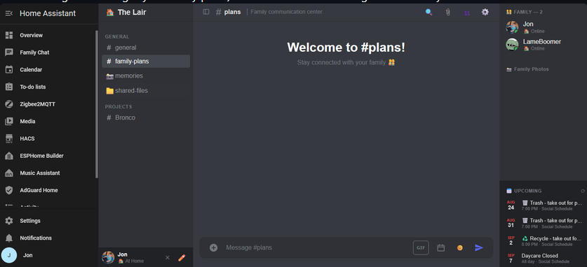

# Family Chat

A private, Discord-like chat application for your family that runs entirely inside [Home Assistant](https://www.home-assistant.io/). No separate accounts to create, no ads, no data mining — just a simple, secure messaging platform where your family can chat, share files, react with emojis, and stay connected. All messages, files, and user data are stored locally on your Home Assistant instance — make sure you have room for all those GIFs and photos your family posts.

[](https://opensource.org/licenses/MIT)
[](https://www.home-assistant.io/)



---

## Table of Contents

- [Overview](#overview)
- [Features](#features)
- [Architecture](#architecture)
- [Installation](#installation)
- [Configuration](#configuration)
- [Home Assistant Automations](#home-assistant-automations)
- [Permissions & Roles](#permissions--roles)
- [Security](#security)
- [Requirements](#requirements)
- [Troubleshooting](#troubleshooting)
- [Changelog](#changelog)
- [License](#license)
- [Support](#support)

---

## Overview

Family Chat is a Home Assistant app that provides a self-hosted, real-time messaging platform for families. It automatically authenticates users through Home Assistant's ingress system — when a family member opens the chat from the Home Assistant sidebar, they're instantly signed in as themselves with no additional login required.

**Key Principles:**
- **Privacy First**: All data stays on your Home Assistant instance
- **No External Dependencies**: No cloud services required (except optional GIPHY)
- **Simple & Familiar**: Uses an interface that's intuitive for all ages
- **Self-Hosted**: You own your data, stored locally in SQLite

---

## Features

### Messaging
| Feature | Description |
|---------|-------------|
| **Real-time Chat** | Messages, reactions, edits, and deletions all appear instantly via WebSockets — no refresh needed |
| **Channels** | Organize conversations into topic-based channels (e.g., `#general`, `#memories`, `#plans`) |
| **Channel Categories** | Group channels under collapsible category headers (Discord-style) |
| **Message Replies** | Reply to specific messages with quoted context; the quote keeps its snapshot even if the original is later edited or deleted |
| **Message Editing** | Fix a typo or reword something after sending — your own messages only, with a small "(edited)" label so it's never hidden that something changed |
| **Formatting** | `**bold**`, `*italic*` or `_italic_`, `` `inline code` ``, ```` ``` ```` code blocks, and lists (lines starting with `- ` or `1. `). Links, @mentions and phone numbers still work inside formatted text. Reply previews, notifications and the pinned list show the text without the marks |
| **Polls** | Quick family votes like "pizza or tacos?" — 2–10 options, one answer or several, with live counts and who voted for what. Tap your pick again to take the vote back |
| **Pinned Messages** | Pin important messages to a channel (up to 50); the 📌 panel in the channel header lists them |
| **Move Messages** | Move a message to a different channel; reactions, poll votes and pins go with it |
| **Typing Indicator** | See when someone is typing in the channel you're viewing |
| **Drafts** | Unsent text stays with its channel when you switch away, and survives a reload |
| **Message Grouping** | Consecutive messages from the same person within a few minutes are visually grouped, Discord-style, instead of repeating the name and avatar every time |
| **Date Dividers** | A "Today" / "Yesterday" / full-date divider appears once per day in the history, not repeated on every message |
| **@Mentions** | Mention family members with `@` — they'll get notified even if they haven't subscribed to the channel |
| **Tap-to-Call** | Phone numbers in a message become links that open your phone's dialer |
| **Unread Indicators** | Bold channel names show new activity; red badges show @mentions |
| **Search** | Search across all channels for message history |
| **Link Previews** | Automatic preview cards for shared URLs (with SSRF protection) — a thumbnail and description for most sites including Facebook and Instagram, an embedded player for YouTube. A failed or blocked preview shows a small, honest fallback card rather than nothing at all |
| **Message History** | Infinite scroll to load older messages (cursor-based pagination) |

### Media & Files
| Feature | Description |
|---------|-------------|
| **File Sharing** | Upload images, videos, documents, and more (configurable file types) |
| **Voice Messages** | Hold the 🎤 button to record and let go to send; slide away to cancel. Plays inline in the chat. Needs Home Assistant opened over HTTPS (see [Requirements](#requirements)) |
| **Drag and Drop** | Drag a file from your computer onto the chat to share it in the channel you're viewing |
| **Screenshot Paste** | Paste screenshots directly from clipboard (Ctrl+V / Cmd+V) |
| **GIF Picker** | Search and post GIFs from GIPHY (requires free API key) |
| **Custom Emoji** | Upload your own emoji for family inside jokes — usable from the picker, or typed directly into a message as `:shortcode:` |
| **Avatar Upload** | Personalize your profile with a custom photo (with circular crop tool) |
| **Image Previews** | Inline previews for uploaded images |

### Calendar Integration
| Feature | Description |
|---------|-------------|
| **Home Assistant Calendar** | View upcoming events from all your HA calendars. The server admin can choose which calendars can be used for this. |
| **Add Events** | Create calendar events directly from chat discussions |
| **Event Details** | Click any event to see full details (date, time, location, description) |
| **Admin Controls** | Restrict which calendars can receive new events |

### Notifications
| Feature | Description |
|---------|-------------|
| **Push Notifications** | Get notified on your phone via Home Assistant Companion App. Tapping one opens the chat on the channel the message was posted in |
| **Per-Channel Subscriptions** | Choose which channels notify you |
| **@Mention Alerts** | Always notified when mentioned, regardless of subscription |
| **Post from Home Assistant** | Any automation can post a message into any channel (see [Home Assistant Automations](#home-assistant-automations)); it's labelled `BOT` and notifies people by their own preferences |

### Customization
| Feature | Description |
|---------|-------------|
| **Display Names** | Set a custom name separate from your Home Assistant username |
| **Profile Cards** | Optionally share your birthdate, anniversary and phone number from Settings. Click anyone's name in the chat to see what they've shared, with a tap-to-call phone number and, if Home Assistant knows where they are, a "Where am I?" button that shows their location on a map, right over the chat |
| **Light/Dark Theme** | Choose the app's color scheme with the `theme` option (see [Configuration](#configuration)) |
| **Custom Chat Name** | Rebrand the chat to match your family name |
| **Collapsible Sidebars** | Hide the channel list for more space |

### Administration
| Feature | Description |
|---------|-------------|
| **Admin Panel** | Password-protected panel for server management |
| **Channel Management** | Add, delete, and reorder channels and categories. Drag a channel by its ⠿ handle to reorder it or move it into another category (works with touch too), in the admin panel or the server owner's own Settings |
| **Activity Log** | A record of every message deletion and move: what the message said, who sent it, and who removed or moved it |
| **User Management** | Set display names for family members |
| **Server Owner** | Designate an owner with elevated privileges |
| **Calendar Restrictions** | Control which calendars can receive events |
| **Backup & Restore** | Download a single file containing every message and every uploaded file, and restore from it later — independent of Home Assistant's own backup system, and a safety net worth having before doing anything risky to the underlying Home Assistant instance. The Backup tab shows the estimated backup size and free disk space |

---

## Architecture

### Tech Stack

| Component | Technology |
|-----------|------------|
| **Backend** | Python 3.11 + Flask |
| **WebSocket** | Flask-SocketIO with Eventlet |
| **Database** | SQLite (persistent storage, automatically migrated from `/data` to the more durable `/config` on first start after upgrading) |
| **Frontend** | Vanilla JavaScript + Custom CSS |
| **Container** | Docker (Alpine Linux 3.19 base) |
| **Security** | Custom AppArmor profile |

### Project Structure

```text
family-chat/                    # repository root
├── family-chat/                # the Home Assistant app itself
│   ├── app/
│   │   ├── server.py           # Flask/SocketIO application
│   │   ├── ha_bridge.py        # Listens for Home Assistant automation events and posts them
│   │   ├── requirements.txt    # Python dependencies
│   │   ├── static/             # CSS, JavaScript, assets
│   │   └── templates/          # HTML templates
│   ├── CHANGELOG.md            # Version history
│   ├── config.yaml             # App configuration schema
│   ├── Dockerfile              # Container build instructions
│   ├── apparmor.txt            # Security profile
│   └── run.sh                  # Container entrypoint
└── tests/                      # Unit tests (see Development and tests)
```

### Key Dependencies

- **Flask ≥3.1.3** — Web framework
- **Werkzeug ≥3.0.6** — WSGI utility library (password hashing, etc.)
- **Flask-SocketIO ≥5.6.1** — Real-time WebSocket communication
- **Eventlet ≥0.40.3** — WSGI server with WebSocket support
- **Python-SocketIO ≥5.16.2** — Socket.IO protocol implementation
- **websocket-client ≥1.7.0** — Connection to Home Assistant's event stream

---

## Installation

### Method 1: App Store (Recommended)

1. In Home Assistant, go to **Settings → Apps → App Store**
2. Click the **⋮** menu → **Repositories**
3. Add this repository URL: `https://github.com/Arbitrary8481/family-chat`
4. Find **Family Chat** in the store and click **Install**
5. Configure the `admin_password` (see [Configuration](#configuration))
6. Click **Start**

### Method 2: Manual Build

```text
# Clone the repository
git clone https://github.com/Arbitrary8481/family-chat.git

# Copy to your Home Assistant apps directory
cp -r family-chat/family-chat /addons/

# Install from local apps in the Home Assistant UI
```

> **Important**: After installation or updates, perform a **Rebuild** (not just Restart) if certain features aren't working — some permissions require a full rebuild to take effect.

---

## Configuration

Configure via the **Configuration** tab in the app's settings:

| Option | Type | Default | Description |
|--------|------|---------|-------------|
| `theme` | `dark` \| `light` | `dark` | UI color scheme |
| `max_file_size` | int (1-100) | `25` | Maximum upload size in MB |
| `admin_password` | password | `changeme` | **Required**: Password for admin panel |
| `giphy_api_key` | password | `""` | Optional: Enables GIF picker |
| `allowed_file_types` | list | `[image/*, video/*, audio/*, application/pdf, text/*]` | Permitted MIME types |

> **Note**: Change the default `admin_password` immediately — `changeme` is not secure!

Everything else — the chat's display name, channels, the server owner, and individual display names — is configured from within the app itself (the admin panel, or each person's own Settings), not from this options screen.

### Getting a GIPHY API Key (Optional)

1. Visit [developers.giphy.com](https://developers.giphy.com/)
2. Create a free account and app
3. Copy the API key to the `giphy_api_key` field

---

## Home Assistant Automations

Any Home Assistant automation can post a message into any Family Chat channel. There is nothing to configure: no port, no URL, no token, and no YAML to edit. An automation fires a Home Assistant event, and Family Chat — which is already connected to Home Assistant — posts it.

### Posting a message

In an automation's actions, add **Fire event** (the "Other actions" list in the automation editor), or in YAML:

```yaml
- event: family_chat_post
  event_data:
    channel: home-alerts            # slug or display name of an existing channel
    title: Chest freezer            # optional, shown on its own line above the message
    message: Door has been open for 10 minutes
    sender: Freezer                 # optional display name, default "Home Assistant"
```

| Field | Required | Notes |
|-------|----------|-------|
| `channel` | yes | A channel's slug or display name; capitalization, spaces and a leading `#` are ignored (`plans`, `family-plans` and `#Family Plans` all match). There is deliberately **no default channel**, so an alert never lands somewhere you didn't choose; a channel that doesn't exist is **refused, not created**, and the error lists the ones that do. |
| `message` | yes | Text, up to 4,000 characters. Templates are fine (`"{{ states('sensor.x') }}%"`). |
| `title` | no | Up to 100 characters; posted on its own line above the message. |
| `sender` | no | The name shown on the message, up to 40 characters. Default `Home Assistant`. |
| `request_id` | no | Any value; echoed back in the result event so an automation can match a result to its post. |

You can `@mention` a family member in the message (`"@Jon the freezer is open"`); like any @mention, it notifies them regardless of their channel subscriptions.

### A ready-made script (optional)

Firing the event directly works anywhere, but a small script gives your automations a friendly form (and one place to change things later). In Home Assistant go to **Settings → Automations & scenes → Scripts → Add script → ⋮ → Edit in YAML**, paste this, and save it as `family_chat_post`:

```yaml
alias: Family Chat - Post message
description: Post a message into a Family Chat channel.
icon: mdi:message-text
mode: queued
max: 10
fields:
  channel:
    name: Channel
    description: The slug or display name of an existing Family Chat channel.
    required: true
    example: home-alerts
    selector:
      text:
  message:
    name: Message
    description: The text to post. Use @Name to mention someone.
    required: true
    selector:
      text:
        multiline: true
  title:
    name: Title
    description: Optional heading, shown on its own line above the message.
    required: false
    selector:
      text:
  sender:
    name: Sender name
    description: Optional name shown on the message. Defaults to Home Assistant.
    required: false
    selector:
      text:
sequence:
  - event: family_chat_post
    event_data:
      channel: "{{ channel }}"
      message: "{{ message }}"
      title: "{{ title | default('', true) }}"
      sender: "{{ sender | default('', true) }}"
```

Any automation can then use it with a plain action:

```yaml
- action: script.family_chat_post
  data:
    channel: home-alerts
    message: The chest freezer door has been open for 10 minutes
```

The script above takes the channel as free text, so it works on any install whatever its channels are called. If you'd rather pick from a dropdown, replace the `channel` field's `selector` with a list of your own channels — `custom_value: true` keeps typing a channel name possible, which matters because a list like this is a snapshot and won't include a channel you add later:

```yaml
    selector:
      select:
        custom_value: true
        options:
          - label: Home alerts
            value: home-alerts
          - label: Family plans
            value: plans
```

### What people see

- The message appears in the channel like any other, with a **BOT** tag next to the sender name so it's never mistaken for a person.
- **Notifications follow each person's own preferences:** a Home Assistant message reaches people who subscribed to that channel, and anyone @mentioned, exactly as a person's message would. There is no separate notification setting.
- Admins and the server owner can delete a bot message. Nobody can edit one.

### Knowing whether it worked

After every event, Family Chat fires `family_chat_post_result` back into Home Assistant:

```yaml
ok: true
channel: home-alerts
message_id: 412
request_id: ...        # if you sent one
# or, on a refusal:
ok: false
error: 'There is no channel "alerts". Existing channels: general, plans, ...'
```

Use it as an automation trigger, or find it in **Developer Tools → Events** (listen to `family_chat_post_result`) while testing.

### Things to know

- **Delivery is best-effort**, like Home Assistant's event bus itself. An event fired while Family Chat or Home Assistant is restarting is not replayed. The connection re-establishes on its own (retrying with a growing pause, up to a minute). For alerts that must never be missed, keep a second channel too, such as a phone push notification.
- **Rate limit:** more than 30 posts in 60 seconds are dropped (each drop is reported as an error), so a misbehaving automation can't bury a channel.
- **Any Home Assistant admin can post**, since anyone who can fire an event can. That matches Family Chat's existing model, where everyone who can open the app is a Home Assistant admin.
- The bridge is isolated from the chat: if it can't connect, it logs the reason and keeps retrying, and messaging is unaffected. Look for `Listening for "family_chat_post" events` in the app log.

### Development and tests

Run the tests from the repository root (no Home Assistant needed):

```bash
pip install -r family-chat/app/requirements.txt
python -m unittest discover -s tests -v
```

The Home Assistant bridge tests use only the standard library. The link preview, poll, voice message, notification, channel reordering and profile tests need the app's own dependencies and are skipped if they aren't installed.

To run the server outside Home Assistant, point it at a scratch folder and, optionally, a real Home Assistant:

```bash
FAMILY_CHAT_DATA_DIR=/tmp/fc-data \
SUPERVISOR_TOKEN=<a long-lived access token> \
HA_API_BASE=http://homeassistant.local:8123/api \
HA_WS_URL=ws://homeassistant.local:8123/api/websocket \
python family-chat/app/server.py
```

---

## Permissions & Roles

Family Chat has a three-tier permission system:

### Everyone (All Users)

- Send messages, voice messages and reactions
- Start polls and vote in them
- Reply to and edit their own messages
- Pin and unpin any message
- Create channels
- Upload custom emoji
- Set personal display name
- Share their birthdate, anniversary and phone number on their profile card
- Manage notification subscriptions
- Delete or move their own messages

### Admin

- Access admin panel (`/admin`) with password
- Delete any channel
- Rename the chat
- Manage everyone's display names
- Restrict calendar access
- Designate server owner
- Reorder channels and categories, and move channels between categories
- Delete or move any message
- View the Activity log of message deletions and moves
- Download or restore a full backup

### Server Owner

- Can delete or move any message, like an admin, tied to their Home Assistant login
- No admin password required day-to-day
- Can delete channels from Settings panel
- Can reorder channels (drag and drop) and categories from Settings panel

> **Note**: Currently, all users need Home Assistant admin access to use the app due to Home Assistant's permission model for ingress-based apps. This doesn't give them admin access on the chat server. Once they change the permissions model I will see what I can do to resolve this.

Editing a message is deliberately sender-only, with no admin or owner override — silently rewriting what someone else appears to have said is a real trust concern, not just a moderation convenience.

---

## Security

Family Chat takes security seriously:

- **Custom AppArmor Profile**: Container is restricted to only necessary filesystem and network access
- **SSRF Protection**: Link previews only connect to public addresses. Every redirect is re-checked, and the connection is pinned to the address that was checked, so a hostname can't switch to an internal address mid-request (DNS rebinding)
- **Input Validation**: All user inputs are sanitized and validated server-side, including poll contents, votes and voice messages sent directly over the socket
- **Session Security**: HttpOnly cookies with SameSite=Lax protection; admin actions that change or download data require a POST
- **Brute-force Protection**: Admin panel locks after 10 failed attempts (5 minutes)
- **No External Exposure**: Only accessible through Home Assistant ingress (no direct port mapping)
- **File Upload Security**: Filename sanitization, type validation, and size limits
- **Backup Restore Checks**: A backup file is checked for path tricks and for an implausible decompressed size before anything is extracted
- **XSS Prevention**: All dynamic content is HTML-escaped, including formatted messages; responses send `X-Content-Type-Options: nosniff`
- **Slow-Input Protection**: Message formatting and link handling take time in proportion to a message's length, so crafted text can't stall the server or anyone's browser

See [SECURITY.md](SECURITY.md) for how to report a vulnerability, and for the full list of security issues fixed so far.

---

## Requirements

### Required

- Home Assistant with Supervisor (Home Assistant OS or Supervised)
- Home Assistant admin access for all users

### Optional

- **GIPHY API Key** — for GIF search functionality
- **Home Assistant Companion App** — for push notifications on mobile devices
- **HTTPS access to Home Assistant** (for example through Home Assistant Cloud, or your own certificate) — for voice messages. Browsers only allow microphone access on secure connections. In the Companion App, also allow microphone access
- **A person in Home Assistant linked to each family member's login, with a tracked device** (Settings → People) — for the "Where am I?" button on profile cards

### Architecture Support

- ✅ `amd64` (x86_64)
- ✅ `aarch64` (ARM64)
- ❌ `armv7` and other 32-bit architectures (deprecated by Home Assistant)

---

## Troubleshooting

| Issue | Solution |
|-------|----------|
| **App won't start** | Check the app log: Settings → Apps → Family Chat → Log |
| **New features missing** | Perform a **Rebuild** (not just Restart) |
| **Notifications not working** | Ensure Companion App is installed and `homeassistant_api` permission is granted |
| **GIF picker missing** | Add a GIPHY API key in configuration |
| **Avatar not updating** | Hard refresh the page (Ctrl+Shift+R) |
| **Phone still shows the old version after an update** | Clear the Companion App's cache (in the app's settings, or your phone's app settings), then reopen the chat |
| **Mic button says HTTPS is needed** | Open Home Assistant through an `https://` address. Voice messages can't record over plain `http://` |
| **Mic button says microphone access is blocked** | Allow microphone access for your browser or the Companion App in your phone's settings |
| **No "Where am I?" button on a profile card** | In Home Assistant, go to Settings → People, open that person, make sure they're linked to their Home Assistant login, and add a device to track. The button can take up to a minute to appear |
| **Mobile sidebar issues** | Tap the ✕ button or dimmed backdrop to close |

### Debug Logs

Enable detailed logging by checking the app logs after reproducing an issue. The app logs explicitly when:

- Notifications are sent (or skipped)
- API errors occur
- Authentication issues happen

---

## Changelog

See [CHANGELOG.md](family-chat/CHANGELOG.md) for detailed version history.

**Recent Highlights:**

- **v2.55.1** — "Where am I?" shows the map over the chat instead of leaving it
- **v2.55.0** — Profile cards with birthdate, anniversary, phone number and a "Where am I?" map button
- **v2.54.0** — Drag a file onto the chat to share it
- **v2.53.0** — Drag-and-drop channel reordering in Settings, like the admin panel
- **v2.52.2** — Plain-text message previews, and a fix for slow-to-process crafted messages
- **v2.52.1** — Tapping a notification opens the chat on the right channel
- **v2.52.0** — Polls, voice messages, message formatting, per-channel drafts, and a light theme fix
- **v2.51.1** — Security fixes (DNS-rebinding SSRF, backup decompression bomb, and more)
- **v2.51.0** — Drag-and-drop channel reordering in the admin panel
- **v2.50.0** — Estimated backup size and free disk space on the Backup tab
- **v2.49.0** — Typing indicator
- **v2.48.0** — Pinned messages
- **v2.47.0** — Tap-to-call phone numbers
- **v2.45.0** — Admin Activity log for message deletions and moves
- **v2.44.0** — Move messages to another channel
- **v2.43.0** — Home Assistant automations can post into any channel

---

## License

MIT License — see [LICENSE](LICENSE) for details.

---

## Support

This is a self-hosted, family-run project. There is no formal support channel.

- **Bugs/Issues**: Check the app logs first, then report any errors via a GitHub issue.
- **Feature Requests**: Open a GitHub issue or submit a pull request.
- **Donations**: [Buy me a coffee](https://ko-fi.com/arbitrary8481) ☕

---

## Attribution

I use Claude (Anthropic) to help build and maintain this project.
